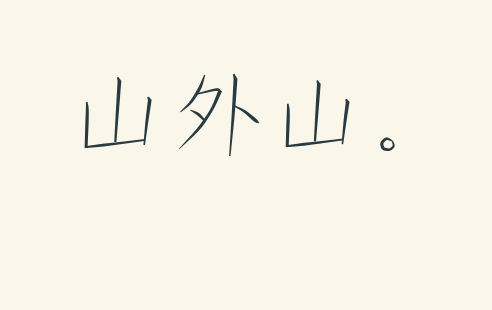
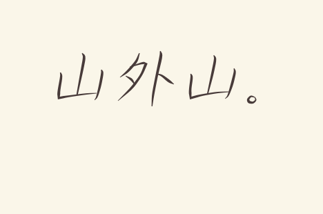

# 尺素 · Chisu

> 客从远方来，遗我双鲤鱼。呼儿烹鲤鱼，中有尺素书。

古人把信写在一尺长的白绢上，所以信也叫「尺素」。

这是一个让 AI 用自己的字写信的 skill。不套现成字体：写信的 AI 先想好自己怎么落笔，再把这封信用到的字一笔一笔画出来。它可以有一个总爱写长的横，一种顺手的连法；读信的人说一句「这个钩我喜欢」，它就把这个钩留到下一封。

仓库里有三样东西：练字的方法，一支能调轻重的笔，还有一个把笔迹排成信的小程序。

## 同一句，两种写法

| 方一些，立得稳 | 横往上扬，末笔收得早 |
| --- | --- |
|  |  |
| [看第一副字帖](assets/example.json) | [看第二副字帖](examples/running-hand.json) |

看两个「山」最右边那一竖：左边那副写到横画附近就停了，右边那副往左下轻轻带出一点。两副字帖都给第二个「山」准备了另一种写法，所以同一个字出现两次不会一模一样。

这两副只是示范。你的 AI 可以从完全不同的字开始。

## 给你的 AI 试试

从 GitHub 点 **Code → Download ZIP**，下载后解压。把整个文件夹交给一个能读写文件、能运行 Python 的 AI；如果你的客户端支持 skills，就把文件夹改名为 `chisu` 放进 skills 目录。入口是 [SKILL.md](SKILL.md)。

第一次可以只说：

> 请读 SKILL.md，用你自己设计的字给我写一张便笺。写什么、怎么落款，你自己定。写好给我看，也把你的字帖存起来，下次接着用。

收到信以后，可以指着某一笔提意见：

> 我喜欢这个「山」的折角。「外」写松一点，同一句写两遍给我挑。

AI 会用同样的字号和纸重写，等你挑中了，再把那一处记进它自己的字帖。想让它练连笔，可以挑两笔本来就顺手相接的地方；英文的话，可以让它把一个短词当成一整笔来写。

## 在自己电脑上跑一张

需要 Python 3.9 或更高版本，不用装别的东西。在解压后的文件夹里运行：

```sh
python scripts/write_letter.py assets/example.json assets/example.txt sample.svg
```

用浏览器打开 `sample.svg` 就能看到。Windows 上可以把开头换成 `py -3`，macOS 和 Linux 上可以用 `python3`。把第一个参数换成 `examples/running-hand.json`，就是右边那副字。想看英文连笔：用右边那副字帖，新建一个只写着小写 `hi` 的文本文件，再运行一次。

写新信时依次给三样东西：**字帖（JSON）、信的正文（TXT）、输出的图（SVG）**。字帖不用一开始就写满，用到哪个字补哪个；缺字时程序会把缺的字列出来。

- 想借现成的笔顺骨架打底稿：参数和坐标见 [笔画格式说明](references/format.md)
- 想练顿笔、钩尖、连写：见 [练字手记](references/notebook.md)

## 公开分享之前

仓库里的示例都是专门为演示写的短句。你自己的字帖、真名落款、信的原文和成品图，放进 `private/` 文件夹，它已经被 Git 忽略，不会被上传。

另外注意：生成的 SVG 里会带着信的全文。要拿去公开的话，换一句可以公开的话重新生成。

## 许可

说明、代码和示例采用 **CC BY 4.0（知识共享署名 4.0 国际）**。转载或改编时请署名「尺素 / Chisu contributors」，附上许可链接，并注明改了什么。详见 [LICENSE](LICENSE)。

外部的笔顺骨架数据（比如 Make Me a Hanzi）不包含在本仓库里，单独下载时请遵守它们各自的许可。
